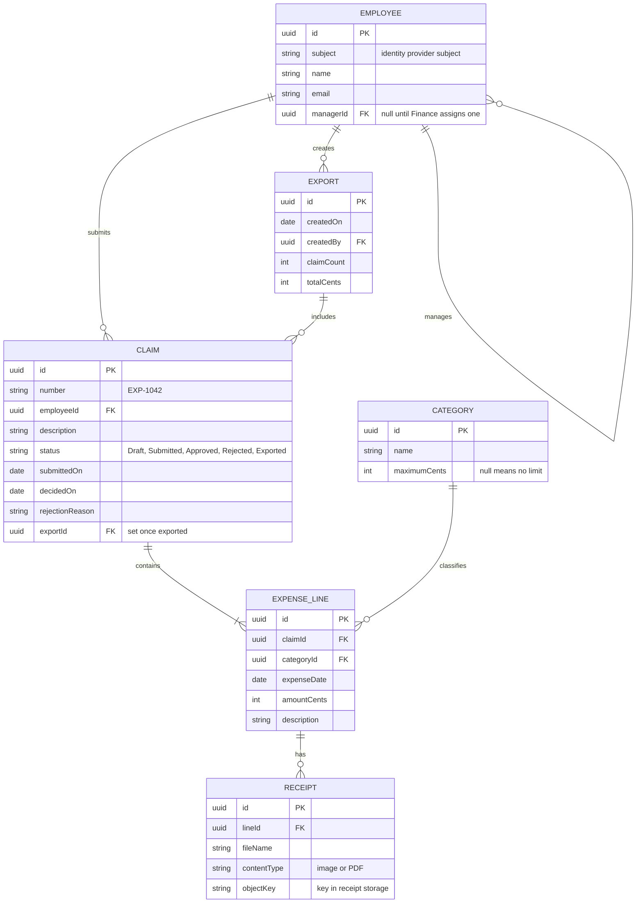

# Domain model

Employees submit claims made of expense lines, each in a category with an optional maximum and with optional receipts. Managers decide claims, and Finance exports approved claims in batches. Amounts are whole cents in one company currency.

A claim's total is the sum of its lines and is never stored. An export's file is regenerated from its claims, so a re-download never changes a claim.